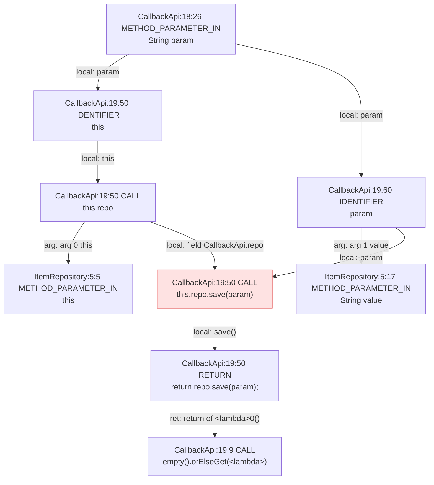
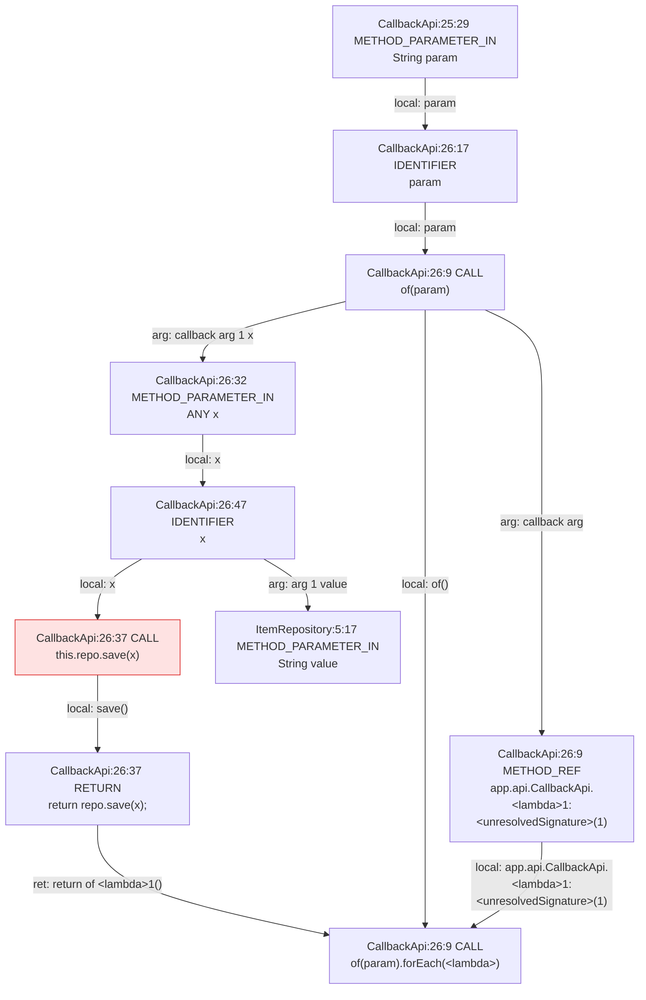
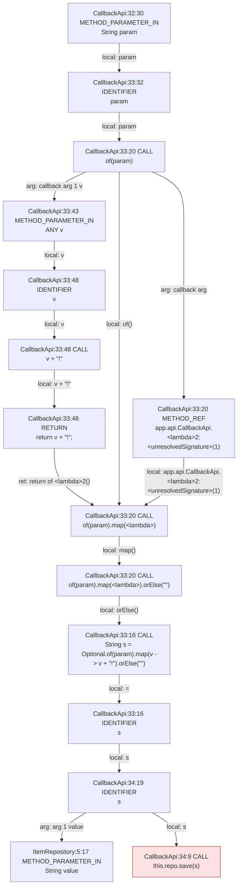
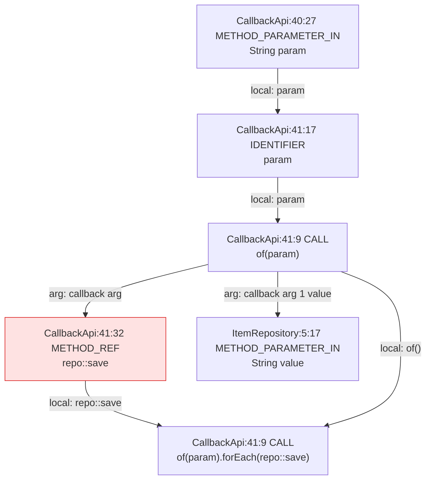
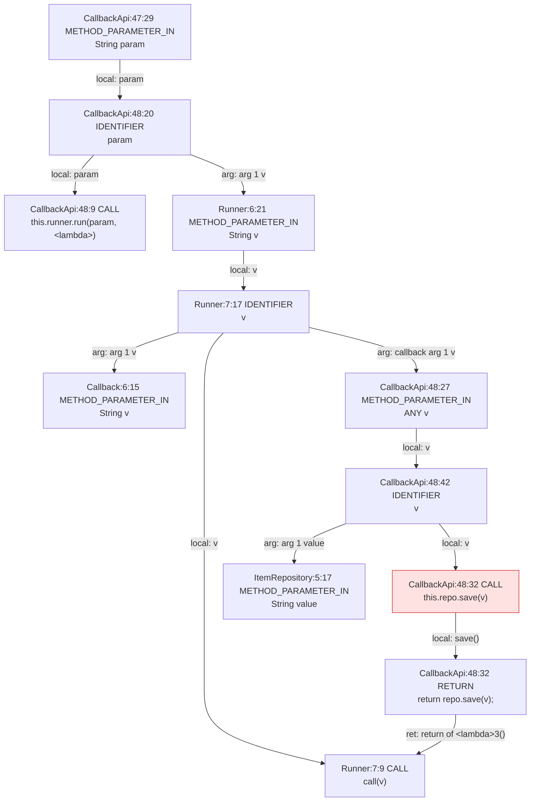
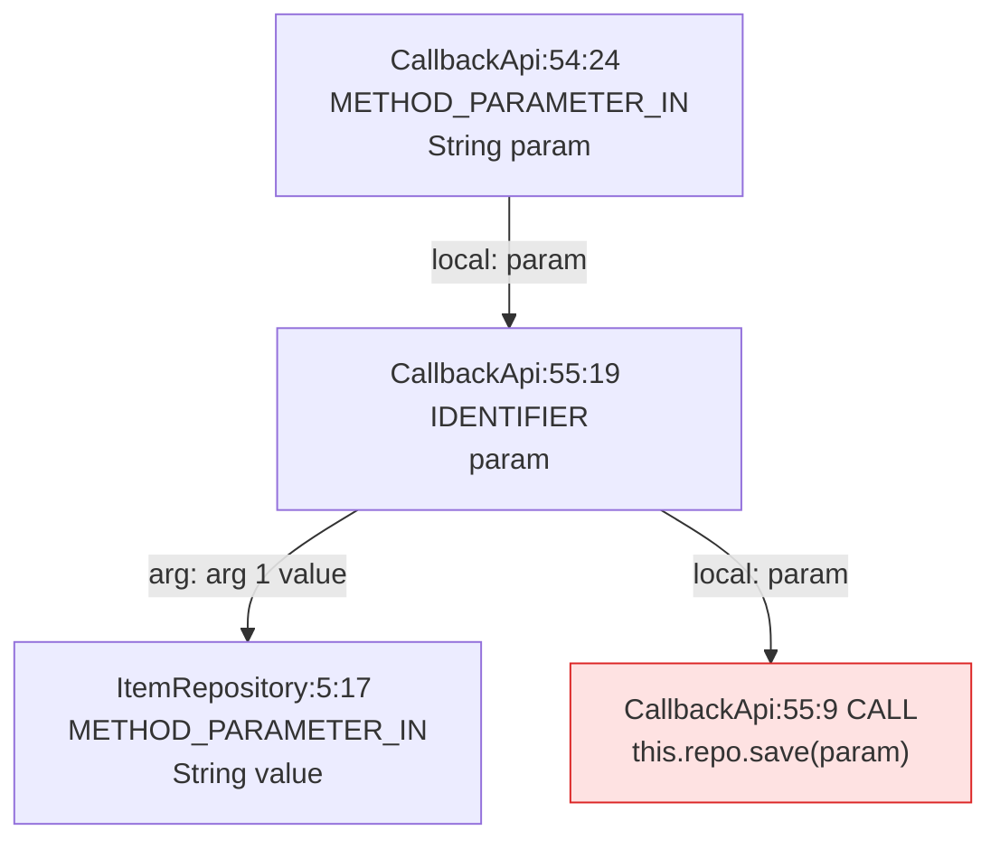

# Callbacks fixture: value graph per scenario

Source: `spike/fixtures/callbacks/graph.json`. Nodes are Joern nodes (`Class:line LABEL` + code), edges are codeflow value edges reachable from each endpoint, labelled `kind: carrier`. Red = db sink (`ItemRepository.save` call); red dashed = a sink in the scenario that the walk does NOT reach (the gap). Regenerate with `UPDATE_SNAPSHOTS=1 spike/test/extract-callbacks.sh`.

## a. lambda captures param (FOUND)

## b. value into lambda parameter (FOUND)

## c. value out of lambda return (FOUND)

## d. method reference repo::save (FOUND)

## e. own Callback interface (FOUND)

## f. direct repo.save (control) (FOUND)

